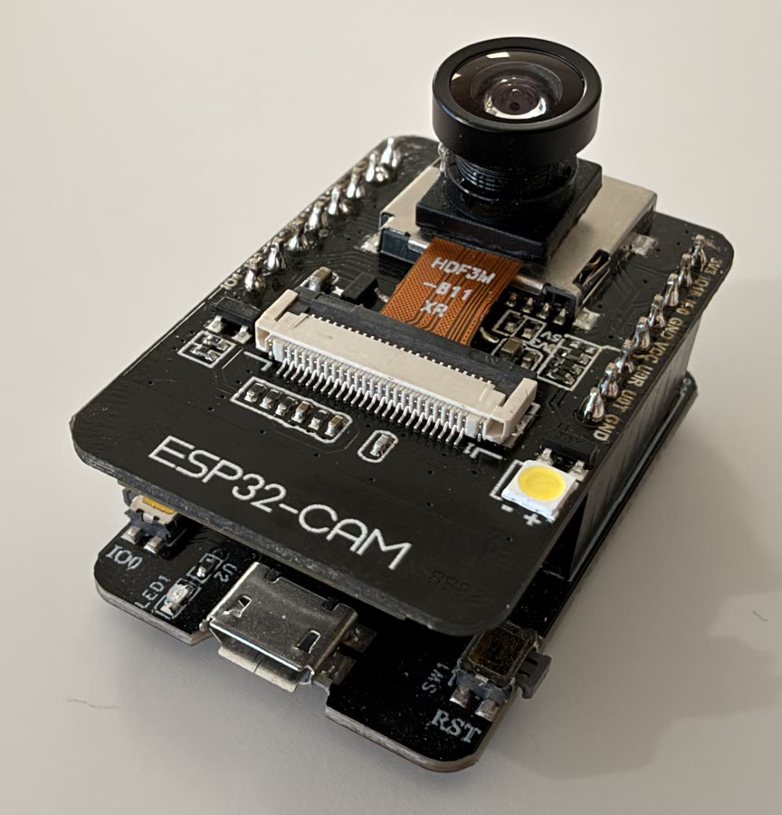
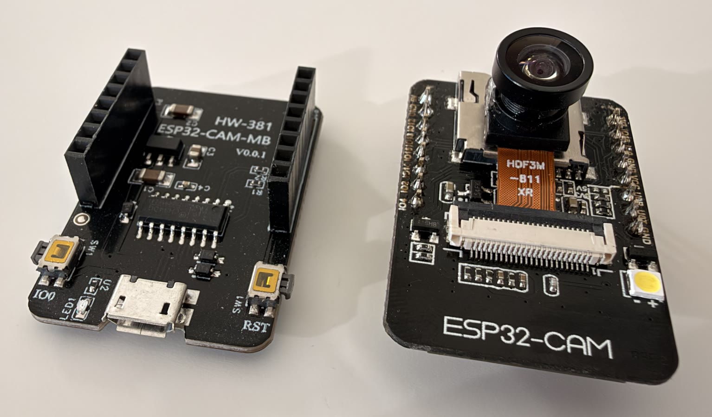

# ESP32-CAM → Apple Home (native HomeKit, no bridge)

<p align="center">
  
</p>

<p align="center">
  
  
</p>

PlatformIO / Arduino firmware for the **AI-Thinker ESP32-CAM** (ESP32-S, 4 MB PSRAM, OV2640) that pairs
**directly** with Apple Home. There is no Home Assistant, Homebridge, Scrypted or any other bridge.

What you get in the Home app:

| Feature | Status |
|---|---|
| Camera tile with JPEG snapshots (HAP `POST /resource`) | ✅ verified |
| Motion sensor (on-device frame differencing) with notifications | ✅ verified |
| **Live video** (H.264 over SRTP, encoded on the ESP32) | ✅ **verified on an iPhone in the Home app**: 160×120 at 15 fps, about 270 kbit/s. Low resolution (software encoder) |
| Browser live view (MJPEG, VGA, 15 fps) + stats | ✅ verified |

## Feasibility: what was checked before building

* **Matter: not possible.** Matter 1.5 added cameras (WebRTC + H.264), but Apple Home does not support Matter
  cameras (as of iOS 27). Espressif's Matter camera example only runs on the ESP32-P4, which has a hardware
  H.264 encoder. The Arduino Matter library has no camera endpoint.
* **HomeKit (HAP over IP): possible, with limits.** HomeKit live video must be **H.264 over SRTP**. The
  ESP32-S has no video encoder (Espressif's `esp_h264` supports only the S3 and P4), so this firmware encodes
  in software with [minih264e](https://github.com/lieff/minih264). That limits live video to small
  resolutions. The older [maximkulkin/esp32-homekit-camera](https://github.com/maximkulkin/esp32-homekit-camera)
  (ESP-IDF + x264) reached 160×120 to 320×240 and crashes after a few live sessions (issues #94, #113).
* **HomeSpan** (the Arduino HomeKit library) has no camera service and no snapshot route. This project
  declares the camera service with HomeSpan's custom TLV8 characteristics and adds an 8-line
  `POST /resource` patch (`patches/homespan-2.1.8-resource.patch`).
* **What Apple Home (iOS 27, HomePod hub) needs from a camera accessory**, all learned on the real device.
  Without these, the camera showed "No Response" while the motion sensor worked:
  * the `Active` characteristic (B0) on the Camera RTP Stream Management service. Home writes it for the
    Off / Detect Activity / Stream setting.
  * the stream management service marked **primary**
  * a **Microphone** service (Mute + Volume), even with no microphone
  * the usual capability lists: H.264 profiles Baseline, Main and High; levels 3.1, 3.2 and 4.0; and
    320×180 to 1920×1080 resolutions. iOS then asks for e.g. 1280×720@30 at 299 kbit/s. The camera answers
    with a smaller Constrained Baseline stream, and the SPS tells iOS the real size.

## Build & flash

```bash
cp include/secrets.h.example include/secrets.h   # Wi-Fi SSID/password (2.4 GHz) + HomeKit code
~/.platformio/penv/bin/pio run                    # build
~/.platformio/penv/bin/pio run -t upload          # flash (see below if it can't connect)
~/.platformio/penv/bin/pio device monitor         # serial log, 115200
```

**Upload on this board.** The ESP32-CAM-MB's auto-reset does not work with this adapter on macOS, so enter
flash mode by hand:

1. Start the upload.
2. Hold **IO0**, press and release **RST**, then hold IO0 for about one more second and release it. Both
   buttons are on the MB board, on either side of the USB port (see the photo above).
3. When flashing is done, press **RST** to boot.

If the port shows no data at all, unplug and replug the USB cable. Close the Arduino IDE serial monitor too,
because it holds the port.

`lib/HomeSpan` is HomeSpan 2.1.8 plus the snapshot patch. To recreate it: `tools/vendor_homespan.sh`.
`lib/minih264` is minih264e (CC0) plus a 4-line ESP-IDF endianness patch (`patches/minih264-esp32.patch`).

## Pair with Apple Home

1. Power the camera and wait about 10 s. The serial log shows `ESP32 Cam is READY!` and the setup code.
2. On the iPhone (same Wi-Fi), open **Home** and tap **+**, then **Add Accessory**.
3. Tap **More options…** and pick **ESP32 Cam**.
4. Apple warns that this is an **Uncertified Accessory**. Tap **Add Anyway**.
5. Enter the setup code. The default is **`204-02-210`** (`HK_PAIRING_CODE` in `include/secrets.h`).
6. Assign a room. The accessory appears as a **camera** tile, with a linked **motion sensor**.
7. Optional: in the camera's settings, turn on motion **notifications**. They include a snapshot.

Notes:
* Snapshots refresh roughly every 10 s while the Home app is open. Tap the tile for live video.
* **The camera shows "No Response" / "Intet svar" after a firmware update that changed the accessory
  layout.** The home hub keeps its old verdict about the camera. Fix it like this:
  1. Remove the accessory in Home.
  2. Type `U` in the serial monitor. Home often doesn't unpair an accessory it thinks is unresponsive, and
     the camera then stays hidden from **Add Accessory**.
  3. Add the camera again.
* Away from home (remote viewing, notifications) needs a **home hub**: an Apple TV or HomePod.
* To reset the pairing, type `U` in the serial monitor, or remove the accessory in the Home app.

## Serial commands (`pio device monitor`, newline-terminated)

| Command | Action |
|---|---|
| `@s` | print stats now (they are also printed every 10 s) |
| `@x12`, `@x8`, `@x20` | change camera XCLK at runtime (MHz) |
| `@p0` … `@p4` | HomeKit live-video profile: 160×120, 240×176, 320×240 (default), 480×320, 640×480. Saved; applies at the next live view |
| `@b` | JPEG→H.264 encoder benchmark (not while streaming) |
| `U` / `W` / `?` | HomeSpan: unpair all / change Wi-Fi / help |

## Web UI (same network)

* `http://esp32cam.local:81/`: live MJPEG view, stats, and XCLK buttons
* `http://esp32cam.local:82/stream`: MJPEG stream (VGA)
* `http://esp32cam.local:81/jpg`: snapshot
* `http://esp32cam.local:81/stats`: JSON with capture fps, stream fps, RSSI, heap, PSRAM, XCLK, motion, and
  live-stream state
* `http://esp32cam.local:81/control?xclk=12` and `/control?profile=2` (0–4, see the table below)

## Measurements (this board, router channel 6, RSSI about −60 to −67 dBm)

### XCLK 8 / 10 / 12 / 16 / 20 MHz (VGA JPEG q12, 30 s each, `tools/xclk_bench.py`)

| XCLK | camera fps | MJPEG fps over Wi-Fi | kbit/s | ping |
|---|---|---|---|---|
| 8 MHz | 10.0 | 10.0 | 1163 | 10 ms |
| 10 MHz | 12.5 | **0.1** | 15 | 2000 ms, 5% loss |
| **12 MHz** | **15.0** | **15.0** | 1742 | 9 ms |
| 16 MHz | 20.0 | 0.9 | 100 | 33 ms, spikes |
| 20 MHz | 25.0 | **0.3** | 34 | 254 ms |

The camera clock interferes with this board's Wi-Fi radio at some frequencies: RSSI barely changes, but
throughput collapses. **12 MHz is the default**: 50% more frames than the commonly recommended 8 MHz, with no
Wi-Fi penalty. Interference depends on the board and the Wi-Fi channel. Re-run
`python3 tools/xclk_bench.py esp32cam.local 30 8,10,12,16,20` if you move the router to another channel.

### H.264 encoding on the ESP32-S (`@b`, minih264e plain C, speed 10)

| camera JPEG → H.264 | JPEG decode | RGB→I420 | encode | fps (one core) |
|---|---|---|---|---|
| VGA → 160×120 | 288 ms | 14 ms | 52 ms | 2.8 |
| QVGA → 160×120 | 99 ms | 14 ms | 59 ms | 5.8 |
| **QQVGA → 160×120** | 33 ms | 14 ms | 45–59 ms | **9.5–11.4** |
| QVGA → 320×240 | 115 ms | 55 ms | 195 ms | 2.7 |

The ROM JPEG decoder costs grow with the source size, so during a live session the camera switches to the
profile's native size. It switches back to VGA afterwards. Decode runs on core 0 and encode on core 1 (a
two-stage pipeline).

### HomeKit live stream (Mac HAP controller acting like iOS, `tools/hk_test.py stream`)

| profile (`@pN` / `/control?profile=N`) | camera source | fps | kbit/s | encode | notes |
|---|---|---|---|---|---|
| 0: 160×120 | QQVGA | **15.0** | 265–303 | 47 ms | smoothest |
| 1: 240×176 | HQVGA | 8.7 | 230 | 97 ms | |
| **2: 320×240** (default) | QVGA | **4.6** | 145 | 175 ms | best balance |
| 3: 480×320 | HVGA | 2.5 | 165 | 320 ms | measured on the iPhone |
| 4: 640×480 | VGA | 1.0 | 25–100 | 740 ms | slideshow; not recommended |

The chosen profile is saved in NVS and survives reboots. Every profile delivers Constrained Baseline H.264
that ffprobe decodes cleanly, with zero SRTP authentication failures (profiles 0–2 were checked with the Mac
client).

Robustness checks:
* 10 back-to-back sessions (start, then stream, then end): 15.0 fps each, no reset, free heap stable at about 85 KB.
* An abandoned session (controller gone, with no keepalive and no END) ends after 30 s, and the camera
  returns to VGA.
* SRTP/SRTCP from the ESP32 is decrypted and authenticated by libsrtp (`pylibsrtp`) with zero failures.

**On an iPhone (Home app, kitchen HomePod as hub):**
* Live view (160×120 profile) started in about 1 s.
* It ran at 15.0 fps and 268–286 kbit/s with zero send errors, and iOS sent RTCP receiver reports
  continuously.
* iOS first opens a short 640×360 / 132 kbit/s preview stream for the tile, then a 1280×720 / 299 kbit/s
  request for the full-screen view.

## Testing without an iPhone

```bash
python3 -m venv .venv && .venv/bin/pip install aiohomekit pylibsrtp
.venv/bin/python tools/hk_test.py -f pairing.json pair <id from dns-sd> 204-02-210
.venv/bin/python tools/hk_test.py -f pairing.json check          # camera TLVs + SetupEndpoints
.venv/bin/python tools/hk_test.py -f pairing.json snapshot a.jpg
.venv/bin/python tools/hk_test.py -f pairing.json stream a.h264 15 # acts like iOS, checks with ffprobe
.venv/bin/python tools/hk_test.py -f pairing.json unpair          # before pairing an iPhone
```

## Layout

```
src/main.cpp         HomeSpan setup, Wi-Fi tuning, serial commands, 10 s stats
src/camera.*         OV2640 init, capture task, shared latest frame, runtime XCLK / frame size
src/motion.*         1/8-scale JPEG decode + background difference -> MotionDetected
src/hk_camera.*      HAP CameraRTPStreamManagement (TLV8), SetupEndpoints/stream control, snapshots
src/live_stream.*    live session: decode (core 0) -> H.264 (core 1) -> RTP -> SRTP/UDP, RTCP SR, timeout
src/rtp_srtp.*       RFC 6184 packetizer, RFC 3711 SRTP/SRTCP (AES-CM-128 + HMAC-SHA1-80, mbedTLS)
src/h264_pipe.*      JPEG -> I420, minih264e wrapper, SPS fix-up, benchmark
src/web.*            esp_http_server: UI/stats/control on :81, MJPEG on :82
tools/               HomeSpan vendoring, XCLK benchmark, HAP test client
```

## Known limitations

* Live video trades resolution for frame rate because the ESP32-S encodes H.264 in software: 320×240 at
  4.6 fps by default, up to 15 fps at 160×120, and down to 1 fps at 640×480. For HD HomeKit video use an
  ESP32-P4 (hardware H.264) or ESP32-S3.
* Motion detection runs at idle priority, so it pauses while a large live stream keeps the CPU busy.
* No audio (the HAP audio config is advertised but no audio is sent). There is no HomeKit Secure Video.
* During a live session, snapshots and the MJPEG page show the smaller streaming resolution.
* HomeSpan prints a harmless `WARNING: Attempt to set value of Characteristic::SetupEndpoints within
  update()` for each live session (HAP's write-then-read pattern).
